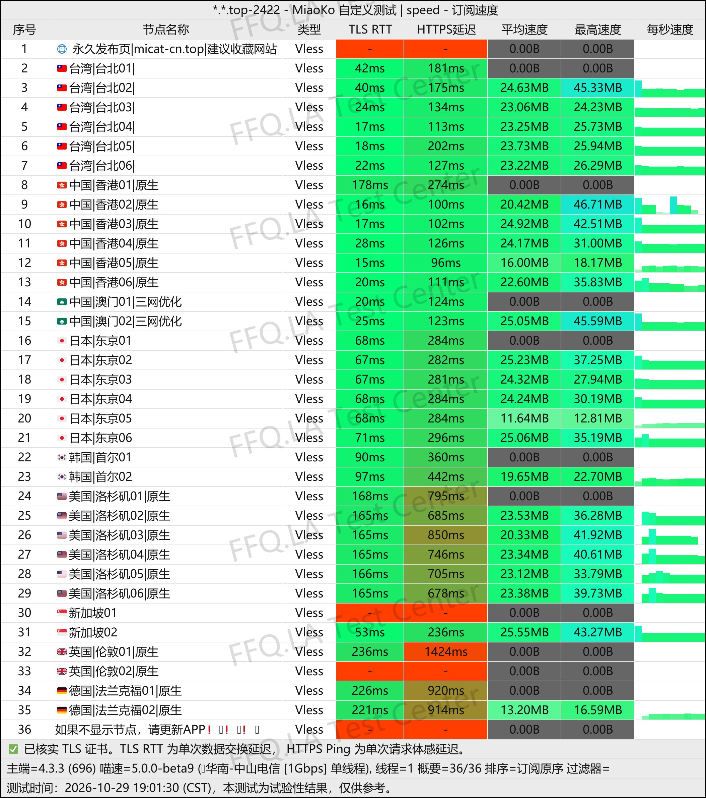
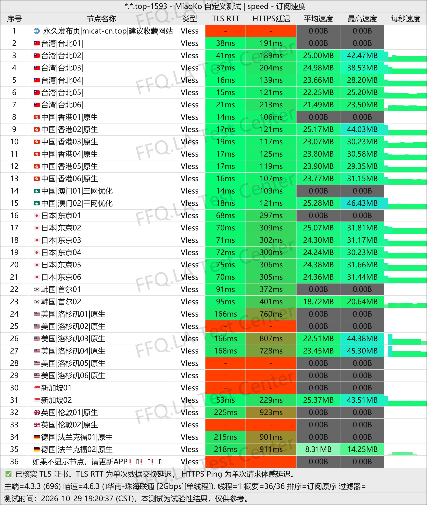
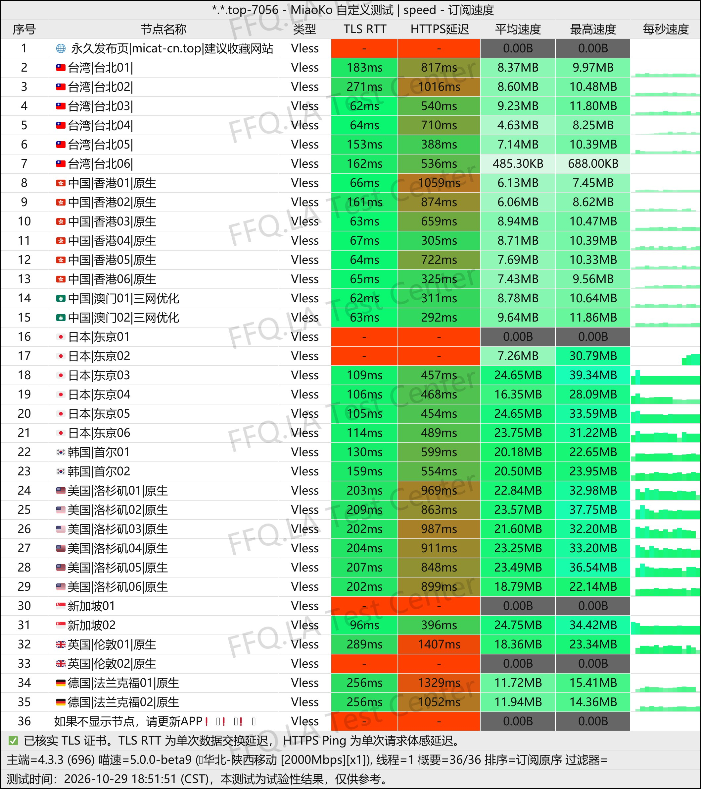
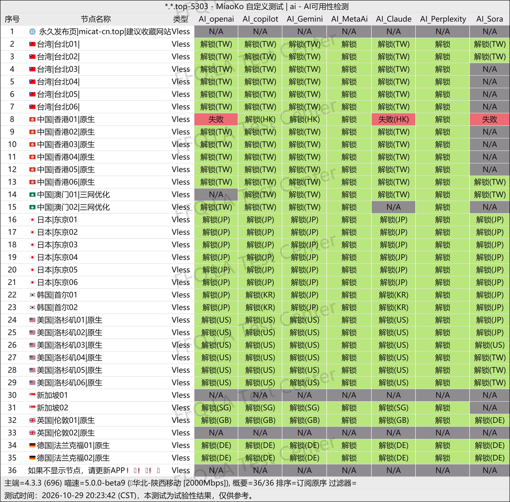
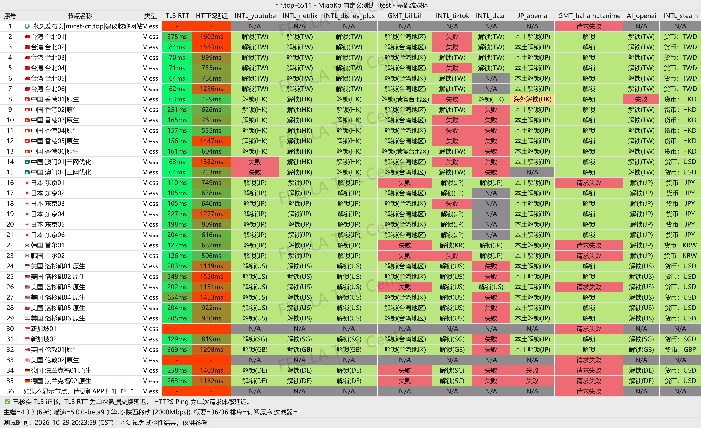
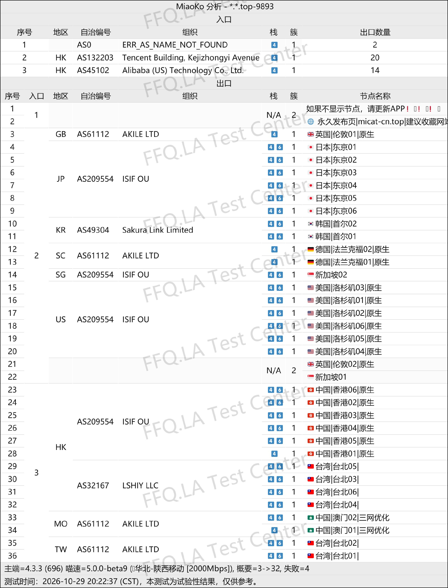

🇨🇳 [中文](README.md) | 🇺🇸 English | 🇷🇺 [Русский](README_RU.md) | 🇮🇷 [فارسی](README_FA.md)

# MiCat VPN Official Website (Updated November 5, 2026)

Official MiCat VPN Website<br>
Latest URL: [micat.cyou](https://to.iix.im/mi01)<br>
Official URL 01: [micat-cn.top](https://micat-cn.top/)<br>
Official URL 02: [zsfcn.top](https://zsfcn.top/)<br>

Best VPN Recommendations and Server List for 2026: [https://github.com/jdnei/JiChangTuiJian](https://github.com/jdnei/JiChangTuiJian)<br>

## Telegram VPN Deals & Community #AD
[VPN Giveaways](https://331024.de/archives/choujiang) | [VPN Chat Group](https://331024.de/archives/choujiang) | [VPN Trial Group](https://331024.de/archives/choujiang)<br>

[https://331024.de/archives/choujiang](https://331024.de/archives/choujiang)

## Invitation Code
```bash
VQzMeUJd
```

## Overview
MiCat VPN, also known as Lost Cat VPN, is a network acceleration service provider launched in 2026. It uses the VLESS protocol and focuses on international relay connections and optimized direct routes.

Its server network covers popular regions, including Hong Kong, Japan, the United States, Singapore, and South Korea.

MiCat offers both monthly subscription plans and non-expiring data packages. It supports popular streaming platforms and AI tools such as ChatGPT, making it suitable for everyday internet access, entertainment, and multi-device users.

## Advantages
MiCat VPN focuses on affordability and value for money, with monthly plans starting at just CNY 3.80.

The service offers different monthly data allowances ranging from 10 GB to 200 GB. Selected plans include IEPL dedicated lines and access to more than 80 servers.

All servers use a standard 1× traffic multiplier, meaning data consumption is counted at its actual rate. Plans support between 5 and 10 devices, and non-expiring data packages are also available.

MiCat uses relay infrastructure from providers such as Alibaba Cloud in Hong Kong and HiNet in Taiwan, offering a balance between everyday connectivity and backup VPN requirements.

## Pricing Plans

| Plan | Monthly Data | Monthly Price | Devices | Server Count | Route Type | Traffic Multiplier | Streaming / AI Unblocking | Notes |
| --- | --- | --- | --- | --- | --- | --- | --- | --- |
| One Cat | 10 GB/month | ¥3.80 | 5–10 | 20+ | Relay Servers | 1× | Streaming / ChatGPT Supported | No refunds; manual subscription configuration required; unavailable in Xinjiang |
| Two Cats | 60 GB/month | ¥8.90 | 5–10 | 20+ | Relay Servers | 1× | Streaming / ChatGPT Supported | No refunds; manual subscription configuration required; unavailable in Xinjiang |
| Three Cats | 200 GB/month | ¥40.00 | 5–10 | 80+ | Relay Servers + IEPL Dedicated Lines | 1× | Streaming / ChatGPT Supported | No refunds; manual subscription configuration required; fair use required for IEPL dedicated lines |

## 📊 Performance Tests & Analysis

#### 1.1 China Telecom Evening Peak-Hour Speed Test
<br>

#### 1.2 China Unicom Evening Peak-Hour Speed Test
<br>

#### 1.3 China Mobile Evening Peak-Hour Speed Test
<br>

#### 2.1 AI Service Unblocking Report
<br>

#### 2.2 Streaming Service Unblocking Report
<br>

#### 3. Entry and Exit Node Analysis
<br>
