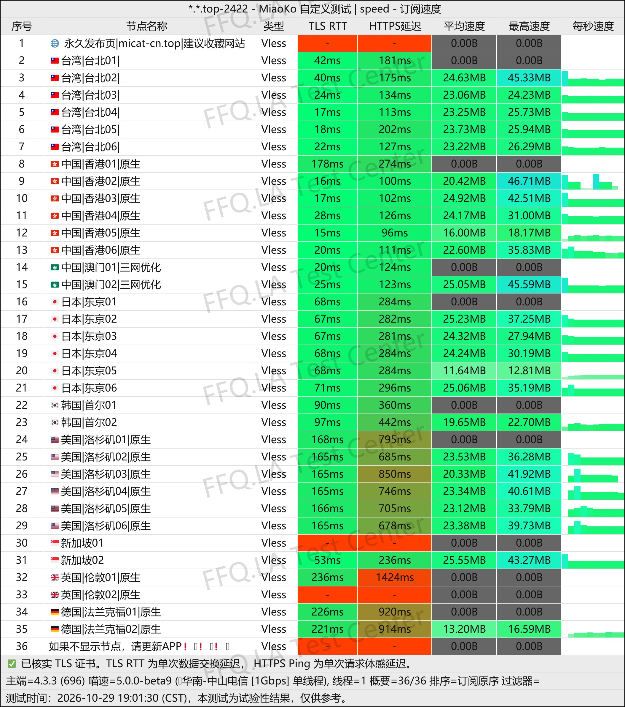
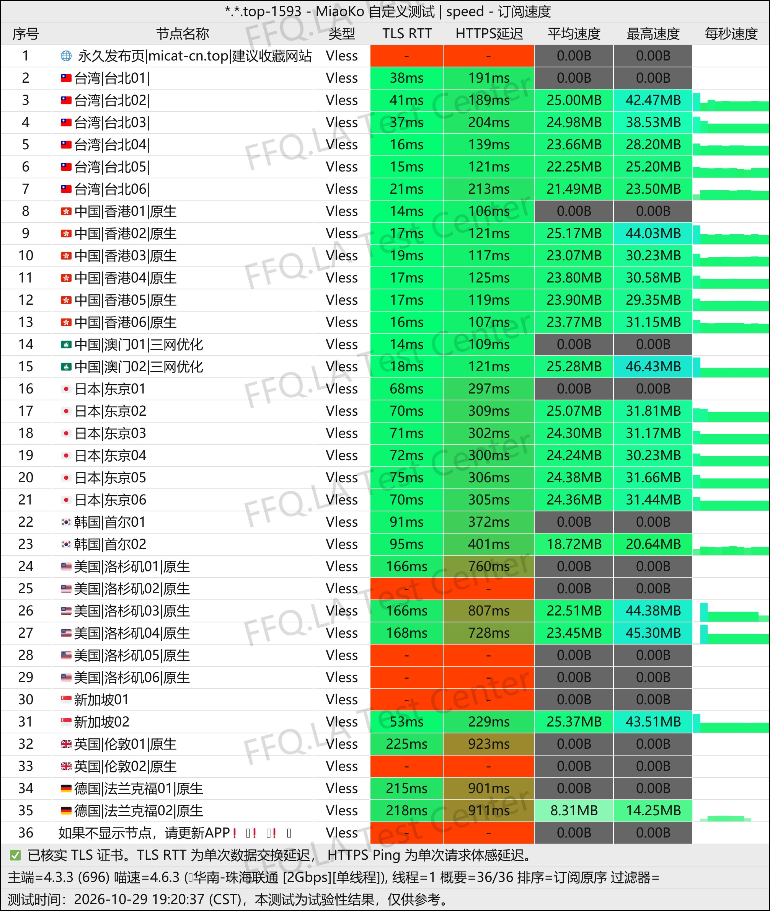
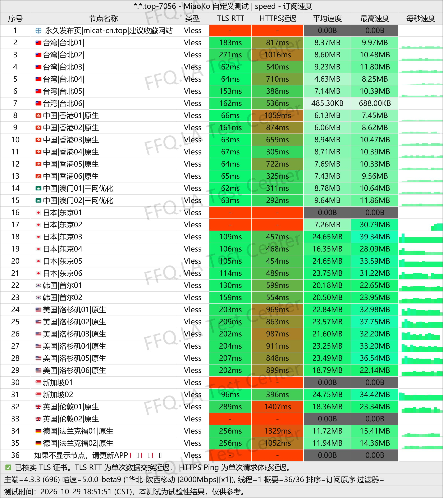
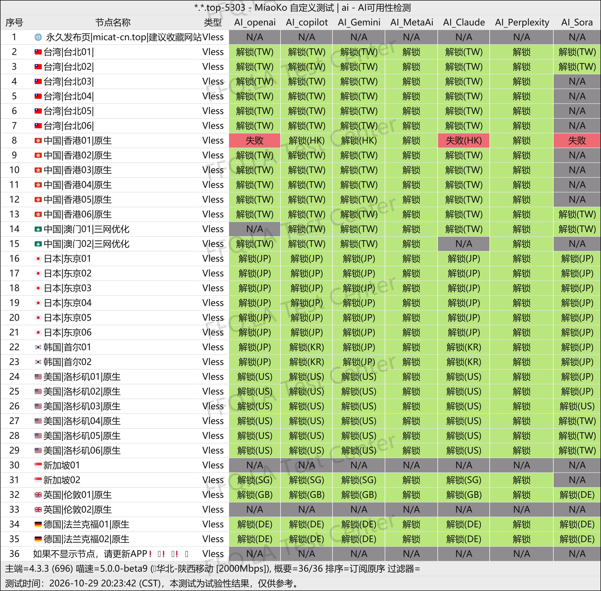
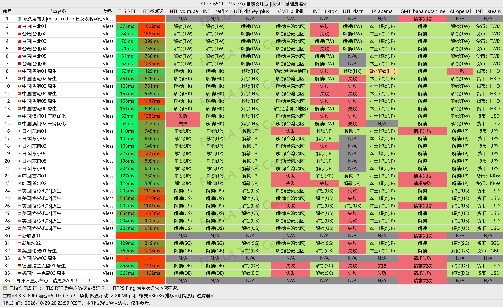
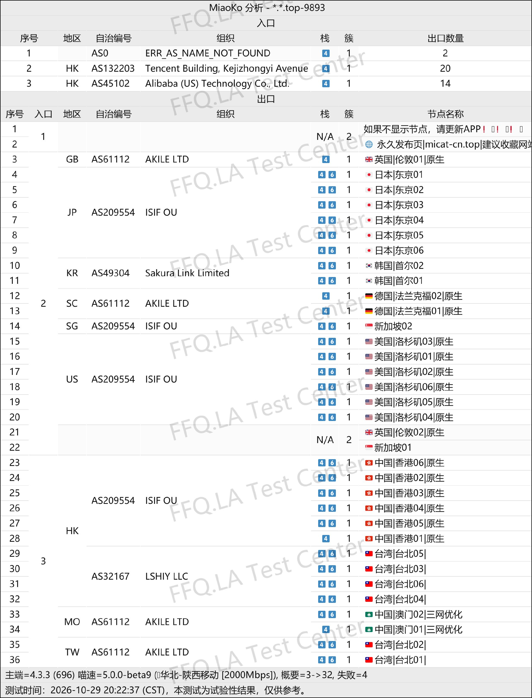

🇨🇳 [中文](README.md) | 🇺🇸 [English](README_EN.md) | 🇷🇺 Русский | 🇮🇷 [فارسی](README_FA.md)

# وب‌سایت رسمی MiCat VPN (به‌روزرسانی ۱ نوامبر ۲۰۲۶)

وب‌سایت رسمی MiCat VPN<br>
آخرین آدرس: [micat.cyou](https://to.iix.im/mi01)<br>
آدرس رسمی ۰۱: [micat-cn.top](https://micat-cn.top/)<br>
آدرس رسمی ۰۲: [zsfcn.top](https://zsfcn.top/)<br>

معرفی بهترین سرویس‌ها و سرورهای VPN در سال ۲۰۲۶: [https://github.com/jdnei/JiChangTuiJian](https://github.com/jdnei/JiChangTuiJian)<br>

## انجمن و پیشنهادهای ویژه VPN در تلگرام #AD
[قرعه‌کشی VPN](https://331024.de/archives/choujiang) | [گروه گفت‌وگوی VPN](https://331024.de/archives/choujiang) | [گروه آزمایش VPN](https://331024.de/archives/choujiang)<br>

[https://331024.de/archives/choujiang](https://331024.de/archives/choujiang)

## کد دعوت
```bash
VQzMeUJd
```

## معرفی
MiCat VPN که با نام Lost Cat VPN نیز شناخته می‌شود، یک ارائه‌دهنده خدمات افزایش سرعت شبکه است که در سال ۲۰۲۶ راه‌اندازی شد. این سرویس از پروتکل VLESS استفاده می‌کند و بر اتصالات رله بین‌المللی و مسیرهای مستقیم بهینه‌شده تمرکز دارد.

شبکه سرورهای آن مناطق محبوبی مانند هنگ‌کنگ، ژاپن، ایالات متحده آمریکا، سنگاپور و کره جنوبی را پوشش می‌دهد.

MiCat هم طرح‌های اشتراک ماهانه و هم بسته‌های ترافیک بدون تاریخ انقضا ارائه می‌کند. این سرویس از پلتفرم‌های محبوب پخش آنلاین و ابزارهای هوش مصنوعی مانند ChatGPT پشتیبانی می‌کند و برای استفاده روزمره از اینترنت، سرگرمی و کاربران دارای چندین دستگاه مناسب است.

## مزایا
MiCat VPN بر قیمت پایین و ارزش خرید بالا تمرکز دارد و طرح‌های ماهانه آن از تنها ۳٫۸۰ یوان چین آغاز می‌شوند.

این سرویس بسته‌های مختلفی با حجم ترافیک ماهانه بین ۱۰ تا ۲۰۰ گیگابایت ارائه می‌کند. برخی طرح‌ها شامل خطوط اختصاصی IEPL و دسترسی به بیش از ۸۰ سرور هستند.

تمام سرورها از ضریب محاسبه ترافیک استاندارد ۱× استفاده می‌کنند؛ یعنی حجم مصرفی بدون ضریب اضافی محاسبه می‌شود. طرح‌ها از ۵ تا ۱۰ دستگاه پشتیبانی می‌کنند و بسته‌های ترافیک بدون تاریخ انقضا نیز در دسترس هستند.

MiCat از زیرساخت رله ارائه‌دهندگانی مانند Alibaba Cloud در هنگ‌کنگ و HiNet در تایوان استفاده می‌کند و تعادلی مناسب میان اتصال روزمره و نیاز به VPN پشتیبان فراهم می‌سازد.

## طرح‌های اشتراک

| طرح | حجم ماهانه | قیمت ماهانه | تعداد دستگاه | تعداد سرور | نوع مسیر | ضریب ترافیک | رفع محدودیت استریم / AI | توضیحات |
| --- | --- | --- | --- | --- | --- | --- | --- | --- |
| یک گربه | 10 GB/ماه | ¥3.80 | 5–10 | +20 | سرورهای رله | 1× | پشتیبانی از استریم / ChatGPT | بدون بازپرداخت وجه؛ تنظیم دستی اشتراک ضروری است؛ در سین‌کیانگ قابل استفاده نیست |
| دو گربه | 60 GB/ماه | ¥8.90 | 5–10 | +20 | سرورهای رله | 1× | پشتیبانی از استریم / ChatGPT | بدون بازپرداخت وجه؛ تنظیم دستی اشتراک ضروری است؛ در سین‌کیانگ قابل استفاده نیست |
| سه گربه | 200 GB/ماه | ¥40.00 | 5–10 | +80 | سرورهای رله + خطوط اختصاصی IEPL | 1× | پشتیبانی از استریم / ChatGPT | بدون بازپرداخت وجه؛ تنظیم دستی اشتراک ضروری است؛ استفاده منصفانه از خطوط اختصاصی IEPL الزامی است |

## 📊 آزمایش عملکرد و تحلیل

#### 1.1 آزمایش سرعت China Telecom در ساعات اوج مصرف شبانه
<br>

#### 1.2 آزمایش سرعت China Unicom در ساعات اوج مصرف شبانه
<br>

#### 1.3 آزمایش سرعت China Mobile در ساعات اوج مصرف شبانه
<br>

#### 2.1 گزارش رفع محدودیت خدمات هوش مصنوعی
<br>

#### 2.2 گزارش رفع محدودیت سرویس‌های پخش آنلاین
<br>

#### 3. تحلیل سرورهای ورودی و خروجی
<br>
